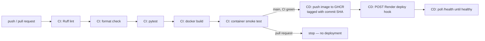

# DevFlow

A small Flask application used as the subject of a complete delivery pipeline: Ruff and
pytest on every push, a Docker image built and smoke-tested, published to GitHub Container
Registry, deployed to Render, then verified against its own `/health` endpoint.

The app is deliberately boring. It has no database, no accounts and no business logic —
its job is to give the pipeline something real to check, and to report honestly what it
knows about the instance serving the page.

> **Status:** the code, tests, container setup and workflows in this repository are
> complete and pass locally. No GitHub Actions run, published image or deployment exists
> yet, so nothing here reports a build as passing or a service as live. Replace the
> placeholders in [Publish, then deploy](#publish-then-deploy) after the first push.

<!--
Badge — uncomment after publishing and replace USER/REPO:
[](https://github.com/USER/REPO/actions/workflows/ci.yml)
-->

## What you get

- **One page** (`/`) that lists the running instance's health, version, environment,
  Python version and build metadata, then the six configured pipeline stages. Server
  rendered; the browser only refreshes the health marker and build fields from the JSON
  API.
- **`/health`** — the endpoint every other part of the system depends on: the Docker
  `HEALTHCHECK`, the CI smoke test, Render's health check and the post-deploy verification
  step all call it.
- **No invented status.** Where the app has no data (a local checkout with no CI
  metadata), it says `not available`. `/api/pipeline` returns configuration with
  `"execution": {"collected": false}` and never a per-stage pass/fail.
- **Security defaults** — security headers on every response, no environment dump, a
  non-root container, Gunicorn instead of the dev server, debug refused in production.
- **Config through environment variables only**, so the same image runs on a laptop, in
  CI and on a host.

## Endpoints

| Route | Returns |
| --- | --- |
| `GET /` | HTML page described above |
| `GET /health` | `{"service":"devflow","status":"healthy","version":"1.0.0"}` |
| `GET /api/info` | name, version, environment, Python version, build metadata |
| `GET /api/pipeline` | the configured stages, marked as configuration only |

## The pipeline



| Stage | Where | What it does |
| --- | --- | --- |
| Code quality | `ci.yml` | `ruff check` and `ruff format --check` |
| Tests | `ci.yml` | `pytest`, JUnit report uploaded as an artifact |
| Build | `ci.yml` | `docker build`, then run the image and curl `/health` (20 attempts) |
| Publish | `cd.yml` | push `ghcr.io/<owner>/<repo>:<sha>` and `:latest` |
| Deploy | `cd.yml` | POST the Render deploy hook, only when the repo variable `DEPLOY_ENABLED=true` |
| Verify | `cd.yml` | poll the deployed `/health` 30 times, 10s apart, and fail if it never answers |

Both files live in `.github/workflows/`.

Two guards matter: `cd.yml` triggers on `workflow_run` completion of CI, so a red CI can
never deploy; and `render.yaml` sets `autoDeploy: false`, so Render cannot deploy behind CI's
back either. A `concurrency` group (`production-deploy`, no cancellation) keeps releases
from overlapping, and pull requests never reach the CD workflow.

## Run it locally

Requires Python 3.12+.

```bash
python -m venv .venv
source .venv/Scripts/activate     # Windows Git Bash; .venv/bin/activate elsewhere
pip install -r requirements-dev.txt

python run.py
```

| URL | |
| --- | --- |
| http://127.0.0.1:5000/ | the page |
| http://127.0.0.1:5000/health | liveness JSON |
| http://127.0.0.1:5000/api/info | instance metadata |
| http://127.0.0.1:5000/api/pipeline | configured stages |

`run.py` reads `PORT` (default 5000), `HOST` (default `127.0.0.1`) and `FLASK_DEBUG`
(default off), and refuses to start with debug on when `APP_ENV=production`. Copy
`.env.example` to `.env` to change the defaults; `.env` is git-ignored.

## Checks

These are the same commands CI runs:

```bash
ruff check .
ruff format --check .
pytest
```

16 tests, no network and no credentials — every test builds the app in-process with
Flask's test client and clears the optional CI environment variables first, so a laptop run
and a CI run behave identically.

## Docker

```bash
docker build -t devflow:local .
docker run --rm -p 8000:8000 -e APP_ENV=production devflow:local
curl -s http://127.0.0.1:8000/health
```

Or with Compose:

```bash
docker compose up --build -d
docker compose ps
docker compose down
```

The image is `python:3.12-slim`, installs only `requirements.txt`, runs as the unprivileged
`devflow` user, serves Gunicorn on `$PORT` (default 8000) with `WEB_CONCURRENCY` workers,
and declares a `HEALTHCHECK` against `/health`. Tests, caches and `.env` are excluded by
`.dockerignore`.

## Publish, then deploy

1. Create an **empty** GitHub repository (no README, no `.gitignore`).
2. Push this folder:

   ```bash
   git remote add origin https://github.com/USER/REPO.git
   git push -u origin main
   ```

3. Replace `USER/REPO` in this README and uncomment the badge at the top.
4. On Render: **New → Blueprint** and pick the repository (it reads `render.yaml`), or
   **New → Web Service → Docker**. Copy the service URL.
5. Add the GitHub configuration below, then run **Actions → CD → Run workflow** for the
   first deployment — or push to `main` and let CI trigger it.

### Required GitHub configuration

*Settings → Secrets and variables → Actions.*

| Kind | Name | Purpose |
| --- | --- | --- |
| Secret | `RENDER_DEPLOY_HOOK_URL` | Render → Service → Settings → Deploy Hook |
| Variable | `APP_BASE_URL` | public service URL, used by the verification step |
| Variable | `DEPLOY_ENABLED` | set to `true`; without it the deploy job is skipped rather than faked |

`GITHUB_TOKEN` is supplied by Actions and is used only by the publish job to log in to
GHCR (`packages: write`; every other job has `contents: read`). Optional: create a
`production` environment with required reviewers to gate the deploy job.

## Repository layout

```text
app/
  __init__.py        app factory, environment and build metadata, security headers
  routes.py          /, /health, /api/info, /api/pipeline
  templates/         base.html, index.html
  static/            css/style.css, js/main.js
tests/               conftest.py, test_app.py
.github/workflows/   ci.yml, cd.yml
Dockerfile           slim base, non-root user, Gunicorn, healthcheck
docker-compose.yml   local container run on :8000
render.yaml          Render blueprint: Docker service, /health, autoDeploy false
pyproject.toml       Ruff and pytest configuration
run.py               local development entry point
.env.example         every setting, documented; no real secrets
SECURITY.md          reporting and secret-handling policy
```

## Troubleshooting

| Symptom | Cause / fix |
| --- | --- |
| `ruff format --check` fails | `ruff format .` and commit the result |
| Container reports `unhealthy` | `docker logs <id>`; make sure the published port matches `PORT` and `/health` returns 200 |
| CD job is skipped | `DEPLOY_ENABLED` is not `true`, or CI did not succeed on `main` |
| CD never starts after CI | `cd.yml` must exist on the default branch (`workflow_run` only sees it there) |
| Health verification times out | Free Render instances cold-start; the step retries for 5 minutes. Otherwise check `APP_BASE_URL` and the service logs |
| GHCR push denied | `packages: write` missing, or the organisation blocks package creation |

## Limitations

- No database, authentication or user data — by design.
- `/api/pipeline` reports configuration only; reading real run results would need an
  authenticated GitHub API call.
- Render builds from the repository `Dockerfile`; pinning it to the exact GHCR image would
  mean changing `render.yaml` to an `image:` source.
- Free Render instances sleep, so the first request after idle is slow.
- Actions are pinned to major tags (`@v4`, `@v5`) rather than commit SHAs. Pin them by SHA
  if you need that guarantee; Dependabot can keep the pins current.
- No coverage threshold, load testing or staging environment.

## License

MIT. Add a `LICENSE` file with the MIT text and your name before publishing.
