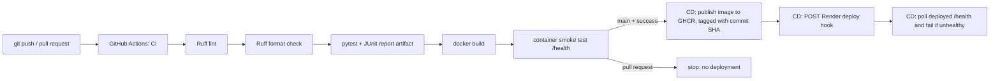

# DevFlow — CI/CD Demonstration Platform

[](https://github.com/YOUR_GITHUB_USERNAME/YOUR_REPO_NAME/actions/workflows/ci.yml)

A small, deliberately readable Flask web application wrapped in a **real** CI/CD
pipeline: GitHub Actions runs code quality checks and tests, builds a Docker image,
publishes it to GitHub Container Registry, deploys it to Render, and then verifies
that the deployed service answers `/health`.

> **Status honesty:** this repository contains working code, tests, workflows and
> container configuration. It does **not** claim a deployment that has not happened.
> Replace the placeholders below after you publish the repository and deploy it.

| Item | Value |
| --- | --- |
| Public demo URL | `TODO: https://YOUR-SERVICE.onrender.com` (placeholder — not deployed yet) |
| CI badge | Replace `YOUR_GITHUB_USERNAME` / `YOUR_REPO_NAME` in the badge and badge link |
| Application version | `1.0.0` (see `app/__init__.py`, overridable with `APP_VERSION`) |

## Screenshots

Add screenshots after your first local run and deployment; the placeholders are
intentional.

| Dashboard | Pipeline detail |
| --- | --- |
| `docs/screenshot-dashboard.png` (placeholder) | `docs/screenshot-pipeline.png` (placeholder) |

## 1. Objectives

1. Show how a code change travels from a commit to a running service automatically.
2. Demonstrate a pipeline that fails loudly when quality or tests fail.
3. Keep every stage small enough to read and reproduce locally in a few commands.
4. Separate **pipeline configuration** from **pipeline results** — the app never
   reports a build status it did not observe.

## 2. Features

- **Dashboard** (`/`): version, environment, live health status (fetched from
  `/health` in the browser), Python runtime, commit/build metadata, pipeline stage
  cards, API reference, dark/light theme toggle with `localStorage` persistence and
  responsive layout.
- **Health probe** (`/health`): JSON liveness response used by Docker, CI and Render.
- **Application info** (`/api/info`): version, environment, interpreter details and
  optional build identifiers. No secrets, no environment dump.
- **Pipeline description** (`/api/pipeline`): the configured stages, explicitly
  marked as configuration only (`"execution": {"collected": false, ...}`).
- **Security headers** on every response, non-root container, no debug in production.
- **Tests and linting** wired into CI; a failure fails the workflow.

## 3. Technology stack

| Concern | Choice |
| --- | --- |
| Backend | Python 3.12, Flask 3.0.3 (application factory) |
| WSGI server | Gunicorn 23.0.0 |
| Frontend | HTML5, CSS3, vanilla JavaScript, Jinja2 templates |
| Tests | pytest 8.3.3 + Flask test client |
| Linting / formatting | Ruff 0.6.9 |
| CI/CD | GitHub Actions (`ci.yml`, `cd.yml`) |
| Container | Docker, `python:3.12-slim`, non-root user |
| Local orchestration | Docker Compose |
| Registry | GitHub Container Registry (GHCR) |
| Hosting | Render (Docker web service, `render.yaml`) |

## 4. Architecture

```text
Browser ──HTTP──> Gunicorn ──WSGI──> Flask app factory
                                      ├── /            Jinja2 dashboard
                                      ├── /health      JSON liveness
                                      ├── /api/info    metadata (no secrets)
                                      └── /api/pipeline configured stages
```

Runtime is a single stateless container. Configuration arrives strictly through
environment variables (`APP_ENV`, `APP_VERSION`, `PORT`, `WEB_CONCURRENCY`, optional
`GIT_COMMIT` / `GITHUB_RUN_NUMBER` / `GITHUB_REF_NAME`), so the same image runs
locally, in CI and on Render.

## 5. CI/CD workflow



- `ci.yml` runs on pushes to `main`, pull requests targeting `main`, and manual dispatch.
- `cd.yml` runs via `workflow_run` **after CI succeeds on `main`**, or manually.
  A `concurrency` group (`production-deploy`, `cancel-in-progress: false`) prevents
  overlapping releases. Pull requests can never trigger it.
- The image publishing job has `packages: write`; every other job has `contents: read`.

## 6. Repository structure

```text
devflow-cicd/
├── app/
│   ├── __init__.py           # app factory, environment/build metadata, security headers
│   ├── routes.py             # /, /health, /api/info, /api/pipeline
│   ├── templates/
│   │   ├── base.html
│   │   └── index.html
│   └── static/
│       ├── css/style.css
│       └── js/main.js
├── tests/
│   ├── conftest.py
│   └── test_app.py
├── .github/workflows/
│   ├── ci.yml
│   └── cd.yml
├── .dockerignore
├── .env.example
├── .gitignore
├── Dockerfile
├── docker-compose.yml
├── pyproject.toml            # Ruff + pytest configuration
├── render.yaml
├── requirements.txt          # runtime dependencies
├── requirements-dev.txt      # runtime + test/lint dependencies
├── run.py                    # local development entry point
├── README.md
└── SECURITY.md
```

## 7. Prerequisites

- Python **3.12+** (`python --version`)
- Git
- Docker Desktop (or Docker Engine + Compose) for the container workflow
- A GitHub account for the CI/CD stages
- A Render account (free plan is enough to try this) for deployment

## 8. Local setup

```bash
git clone https://github.com/YOUR_GITHUB_USERNAME/YOUR_REPO_NAME.git
cd devflow-cicd          # or your repository name
```

### Virtual environment

```bash
python -m venv .venv
# macOS / Linux
source .venv/bin/activate
# Windows (PowerShell)
.venv\Scripts\Activate.ps1
# Windows (Git Bash / cmd)
source .venv/Scripts/activate
```

### Install dependencies

```bash
python -m pip install --upgrade pip
pip install -r requirements-dev.txt   # runtime + pytest + ruff
# or, runtime only:
pip install -r requirements.txt
```

Optional configuration: `cp .env.example .env` and adjust. The app reads variables
from the process environment, so export them (`set -a; source .env; set +a`) or use
your shell/IDE configuration. `.env` is git-ignored.

## 9. Run the application locally

```bash
python run.py
# Dashboard:      http://127.0.0.1:5000/
# Health:         http://127.0.0.1:5000/health
# Application:    http://127.0.0.1:5000/api/info
# Pipeline:       http://127.0.0.1:5000/api/pipeline
```

`run.py` uses Flask's development server and reads `PORT`, `HOST` and `FLASK_DEBUG`
(default `0`). It refuses to start with `FLASK_DEBUG=1` when `APP_ENV=production`.

## 10. Run the tests

```bash
pytest                          # quiet, summary at the end
pytest -v                       # one line per test
pytest --junitxml=reports/junit.xml   # machine-readable report (CI does this)
```

The suite uses Flask's test client only: no network, no credentials, no external
services. It includes a test that clears optional CI environment variables so results
are identical on a laptop and in CI.

## 11. Run Ruff

```bash
ruff check .            # lint
ruff format --check .   # formatting check (CI gate)
ruff format .           # apply formatting locally
```

## 12. Docker

```bash
# Build
docker build -t devflow:local .

# Run (maps container 8000 to host 8000)
docker run --rm -p 8000:8000 -e APP_ENV=production devflow:local

# Check
curl -s http://127.0.0.1:8000/health

# Inspect
docker ps
docker logs <container-id>
docker inspect --format '{{.State.Health.Status}}' <container-id>

# Stop
docker stop <container-id>
```

The image uses `python:3.12-slim`, installs only `requirements.txt`, runs as the
unprivileged `devflow` user, serves with Gunicorn on `$PORT` (default `8000`), and
declares a `HEALTHCHECK` against `/health`.

## 13. Docker Compose

```bash
docker compose up --build -d     # build + start in the background
docker compose ps                # status (including health)
docker compose logs -f           # follow logs
curl -s http://127.0.0.1:8000/health
docker compose down              # stop and remove the container
```

Set `HOST_PORT` to publish a different host port, e.g. `HOST_PORT=8080 docker compose up -d`.

## 14. GitHub repository setup

1. Create an **empty** repository on GitHub (no README, no `.gitignore`).
2. Initialize locally and push (see [section 19](#19-publish-the-repository)).
3. Replace `YOUR_GITHUB_USERNAME` and `YOUR_REPO_NAME` in this README so the badge
   points to your repository:
   - Badge image URL: `https://github.com/<user>/<repo>/actions/workflows/ci.yml/badge.svg`
   - Badge link: `https://github.com/<user>/<repo>/actions/workflows/ci.yml`
   Until you do, the badge points at a non-existent repository — do not present it
   as a passing build.
4. Enable **Actions** if your account/organization disables workflows by default
   (*Settings → Actions → General → Allow all actions and reusable workflows*).
5. Recommended: *Settings → Branches → Add branch protection rule* for `main`,
   requiring the `CI / Lint, format and test` and `CI / Build Docker image` checks.

## 15. Container registry (GHCR)

`cd.yml` publishes to **GitHub Container Registry** using the workflow's ephemeral
`GITHUB_TOKEN` — no personal access token is needed:

```text
ghcr.io/<owner>/<repo>:<commit-sha>
ghcr.io/<owner>/<repo>:latest
```

Requirements:

- Workflow permission `packages: write` (already set on the publish job).
- Repository setting *Settings → Actions → General → Workflow permissions* must allow
  read/write for `GITHUB_TOKEN`, or the job's `permissions:` block must be allowed.
- The package is created on the first successful push. Afterwards, open the package
  settings on GitHub to set visibility (public/private) and link the repository.
- Private packages need a registry login wherever the image is pulled.

## 16. Hosting and deployment (Render)

`render.yaml` defines a Docker web service on Render's **free** plan:

- Build: repository `Dockerfile`, context `.`
- Health check path: `/health`
- `autoDeploy: false` — deployments are triggered by `cd.yml`, not by every push
  (Render would otherwise deploy even if CI failed)
- Start command comes from the image (`gunicorn`, port `$PORT`)

Steps:

1. Push the repository to GitHub.
2. On Render: **New → Blueprint**, select the repository (Render reads `render.yaml`),
   or **New → Web Service → Docker** and point it at the repository.
3. Note the service URL, e.g. `https://devflow-xxxx.onrender.com`.
4. Open *Service → Settings → Deploy Hook* and copy the hook URL.
5. Configure the GitHub secrets/variables in [section 17](#17-required-github-secrets-and-variables).
6. Run **Actions → CD → Run workflow** (manual dispatch) for the first deployment, or
   push to `main` and let CI trigger it.

**Free-tier limitations (verify current terms):** free instances sleep after
inactivity (first request afterwards is slow — the verification step retries for up
to 5 minutes), resources are limited, and Render's pricing/plan names change. This
project does not assume a permanently free tier; check Render's current pricing
before relying on it. Any other Docker-capable host can replace Render — only the
deploy step of `cd.yml` would need to change.

## 17. Required GitHub secrets and variables

Configure under *Settings → Secrets and variables → Actions*.

| Kind | Name | Purpose |
| --- | --- | --- |
| Secret | `RENDER_DEPLOY_HOOK_URL` | Render deploy hook URL. Never printed; sent only to Render. |
| Variable | `APP_BASE_URL` | Public base URL of the deployed service, e.g. `https://devflow-xxxx.onrender.com`. Used to verify `/health`. |
| Variable | `DEPLOY_ENABLED` | Set to `true` to allow the deploy job to run. Without it the job is skipped (it never fakes success). |
| Automatic | `GITHUB_TOKEN` | Provided by Actions; used only to log in to GHCR with `packages: write`. |

No secret is required for CI: linting, tests and the image build run with
`contents: read` and no credentials. Optional: create an **environment** called
`production` (used by the deploy job) and add required reviewers for manual approval.

## 18. Troubleshooting

| Symptom | Cause / fix |
| --- | --- |
| `ruff format --check` fails locally | Run `ruff format .`, commit the result. |
| `docker build` fails on `pip install` | No network access, or an invalid pin in `requirements.txt`. Check the pip error above the failure. |
| Container is `unhealthy` | Check `docker logs <id>`; verify `PORT` matches the published port and `/health` returns 200. |
| `docker run` port already allocated | Another process uses 8000; use `-p 8080:8000`. |
| CD job is skipped | `DEPLOY_ENABLED` is not `true`, or CI did not succeed on `main`. |
| CD never starts after CI | `workflow_run` workflows must exist on the default branch; push `cd.yml` to `main` first. |
| Deploy hook returns 401/404 | The hook URL is wrong or was rotated in Render; update `RENDER_DEPLOY_HOOK_URL`. |
| Health verification times out | Free instance is cold-starting (retry), the service failed to boot, or `APP_BASE_URL` is wrong/missing a scheme. |
| GHCR push denied | `packages: write` missing, or the organization blocks package creation. |
| Badge shows "no status" | Repository placeholders in the README were not replaced. |

## 19. Publish the repository

```bash
# Inside the project folder, with no existing .git directory
git init -b main
git add .
git commit -m "feat: DevFlow CI/CD demonstration platform"
git remote add origin https://github.com/YOUR_GITHUB_USERNAME/YOUR_REPO_NAME.git
git push -u origin main
```

If the repository already has history, do **not** re-initialize it. Add the remote
and push the existing branch instead:

```bash
git remote add origin https://github.com/YOUR_GITHUB_USERNAME/YOUR_REPO_NAME.git
git push -u origin main
```

Before pushing, confirm no secrets are tracked: `git status --ignored` should list
`.env` as ignored, and `git grep -nE "(api[_-]?key|secret|password|token)\s*=" ` should
only show documentation or placeholder lines. `gh` (GitHub CLI) is optional; if it is
installed and authenticated you can create the repository with
`gh repo create YOUR_REPO_NAME --public --source=. --remote=origin --push`.

## 20. Known limitations

- Stateless demo app: no database, authentication or user data.
- `/api/pipeline` returns configuration metadata only; it does not read GitHub
  Actions run results (that would need an authenticated API call).
- The CD workflow gates on repository variables, so it is **skipped** until
  `DEPLOY_ENABLED=true` is set — it never reports a fake success.
- Render free instances sleep, so the first request after idle can be slow.
- Images are published to GHCR but the Render blueprint builds from the repository
  Dockerfile; pinning Render to the exact GHCR image requires changing `render.yaml`
  to an `image:` source.
- No coverage threshold, no load/security scanning, no multi-environment (staging)
  deployment — all intentional to keep the project approachable.

## 21. Future improvements

- Pull `GITHUB_SHA`/run number through a small authenticated endpoint for real build
  cards on the dashboard.
- Add coverage reporting and a minimum coverage gate.
- Add Dependabot for pip, GitHub Actions and Docker updates.
- Add a staging environment and promote the same image digest to production.
- Pin third-party Actions to immutable commit SHAs (see below).
- Add a `deploy` step for an alternative host to show provider independence.

### A note on action pinning

The workflows use major-version tags (`actions/checkout@v4`,
`actions/setup-python@v5`, `actions/upload-artifact@v4`). For a security-focused
setup, replace each tag with the immutable commit SHA of the release you reviewed:

```yaml
- uses: actions/checkout@<40-char-sha> # v4.x.y
```

Resolve SHAs with `git ls-remote https://github.com/actions/checkout refs/tags/v4.2.2^{}`
and let Dependabot keep them current. SHAs are not pre-filled here because an
unverified SHA would break the workflow.

## 22. License

Released under the MIT License. Add a `LICENSE` file with the MIT text and your name
before publishing, or replace this section with the license you prefer.
